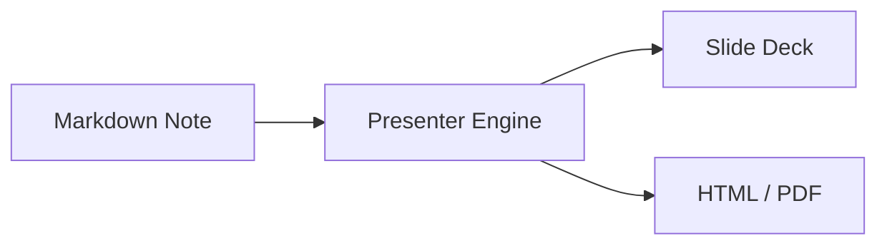

# Obsidian Presenter デザインパターン集 (Design Patterns)

スライドの目的や伝えたい内容に応じて最適なレイアウトを選択するためのパターン集です。

---

## パターン 1: 課題 vs 解決策（2カラム比較）

現状のペインポイントと、提案するソリューションを左右で対比させる定番の構図です。

```markdown
## 課題と解決アプローチ

<!-- columns 2 card -->

### 従来の課題
- [課題] 資料作成に平均3時間を消費
- PowerPointのレイアウト崩れ・フォント調整
- AIが生成した文章の再フォーマットが面倒

### 本プラグインの解決策
- [POINT] Markdownを書くだけで即座にスライド化
- 自動レイアウトでデザイン崩れゼロ
- 思考と執筆のリードタイムを極小化

<!-- /columns -->

> [!important] 導入効果
> 本来時間を割くべき「企画内容の検討」に集中できる環境を実現します。
```

---

## パターン 2: 3ステップのプロセス・フロー

導入ステップ、開発フェーズ、利用手順などを時系列で示すパターンです。`step` オプションにより番号バッジが自動付与されます。

```markdown
## 導入までのロードマップ

<!-- columns 3 step card -->

### フェーズ 1: 試行
- プラグインのインストール
- 個人ノートでのスライド化検証
- チーム内でのフィードバック収集

### フェーズ 2: 運用
- 提案書テンプレートの配布
- 定例ミーティングでの実運用
- 共有用HTML/PDF出力の標準化

### フェーズ 3: 展開
- 全社ナレッジベースとの統合
- スライド作成ガイドラインの策定
- 効果検証と継続的な改善

<!-- /columns -->
```

---

## パターン 3: 図表・コード ＋ 解説（2:1 比率）

左側に大きな画像やアーキテクチャ図、表、コードブロックを置き、右側に要点解説を配置する構図です。`plain` を指定してスッキリ見せます。

```markdown
## システム構成とデータ連携

<!-- columns 2:1 plain -->

### システムフロー図


### 設計の要点
- [重要] 完全ローカル動作（外部送信なし）
- リアルタイムプレビューによる高速イテレーション
- 単一自己完結HTMLによるワンクリック共有

<!-- /columns -->

> [!note]
> システム構成の詳細は社内Wikiのリンク先を参照してください。
```

---

## パターン 4: KPIビッグナンバー & 成果サマリー

プロジェクトの定量的成果や目標数値を強調するパターンです。太字の単独行が自動的に巨大数字になります。

```markdown
## プロジェクト導入実績

<!-- columns 2 card -->

### 作成工数の削減率
**-65%**
週平均4.2時間から1.5時間へ短縮

### 資料共有スピード
**4.0x**
単一HTML配布により即日合意形成を実現

<!-- /columns -->

> [!tip] 現場の声
> 「スライドの見た目を整える作業から完全に解放された」との高評価を獲得。
```

---

## パターン 5: 中扉スライド（セクション区切り）

アジェンダの各パートの開始時に挿入するスライドです。見出しのみを記述することで中央に大きく表示されます。

```markdown
## 02. 具体的な提案内容
```

---

## パターン 6: ビッグステートメント（キーメッセージ・引用）

プレゼン全体で最も伝えたい強い主張や、顧客の声・名言を1枚のスライドで堂々と打ち出すパターンです。

```markdown
## 私たちが提供するコアバリュー

> 「Markdownをただメモとして終わらせない。
> 思考のアウトプットをそのまま世界への発信力に変える。」
```

---

## パターン 7: 機能・競合比較表

表形式（Markdownテーブル）を使って、製品や機能の優位性を明快に示すパターンです。

```markdown
## 他社ツールとの比較

| 評価軸 | Obsidian Presenter | 一般的なスライドツール | 他プラグイン |
| :--- | :---: | :---: | :---: |
| **標準Markdown互換** | ◯ (崩れない) | × (バイナリ) | △ (独自記法多め) |
| **オフライン・安全性** | ◯ (完全ローカル) | △ (クラウド前提) | ◯ (ローカル) |
| **非エンジニア配布** | ◯ (自己完結HTML) | ◯ (PPTX) | × (環境依存) |
| **リアルタイムプレビュー** | ◯ (カーソル追従) | × | △ |

> [!important] 結論
> 社内ナレッジのセキュリティを保ちつつ、直感的な共有が可能です。
```
