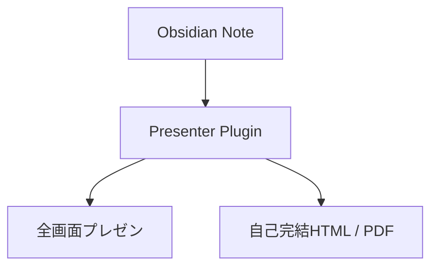

# 新規サービス企画提案
思考の速度でスライドを生み出す次世代プレゼンワークフロー

発表者: プロジェクト推進室
日付: 2026-10-26

## アジェンダ

<!-- columns 3 step card -->

### 01. 背景・課題
現状の業務課題と
解決に向けた仮説

### 02. 提案ソリューション
サービスコンセプトと
主要機能・提供価値

### 03. 導入効果・計画
期待されるROIと
今後のロードマップ

<!-- /columns -->

## 01. 背景と現状の課題

## 現場が直面する3つの課題

<!-- columns 3 card -->

### 資料作成の長期化
- [課題] 週平均5時間を作業に費消
- フォント・レイアウトの手作業修正
- 本来の思考・企画時間が圧迫

### バージョン管理の形骸化
- 複数名編集による先祖返り
- バイナリファイルでの差分追跡不可
- ファイル名に日付が増殖

### ナレッジのサイロ化
- ドキュメントとスライドの二重管理
- ノートアプリからPPTへの転記作業
- 情報の鮮度低下

<!-- /columns -->

## 私たちが目指すアプローチ

> 「思考のMarkdownをそのまま他者への展開資料に変換し、
> 議論と意思決定のサイクルを最速化する。」

## 02. 提案ソリューション

## サービス概要と提供価値

<!-- columns 2:1 plain -->

### システムの全体像

### 提供するコアバリュー
- [POINT] **標準Markdown準拠**: ノートがそのままスライドに
- [POINT] **リアルタイム確認**: カーソル追従プレビュー
- [POINT] **非エンジニア共有**: ブラウザだけで動くHTML配布

<!-- /columns -->

## 競合・従来ツールとの比較

| 評価軸 | 提案システム | 従来のPowerPoint | 他社Markdownツール |
| :--- | :---: | :---: | :---: |
| **作成リードタイム** | **即時（0分）** | 数時間 | 数十分 |
| **標準記法互換性** | **100% (完全準拠)** | × (専用形式) | △ (独自記号) |
| **チーム配布性** | **単一HTML / PDF** | PPTXファイル共有 | Markdown閲覧環境必須 |
| **セキュリティ** | **完全ローカル** | クラウド依存あり | ツール依存 |

> [!important] 採択の決め手
> 社内の情報セキュリティ基準を遵守しつつ、他部署への配布・閲覧性を最大化できます。

## 03. 導入効果と今後の計画

## 期待される定量的効果

<!-- columns 2 card -->

### 資料作成工数の削減
**-70%**
週5時間から1.5時間へ短縮

### 意思決定リードタイム
**2.5x**
ドキュメント即日共有により合意形成を加速

<!-- /columns -->

## 実現に向けたロードマップ

<!-- columns 3 step card -->

### STEP 01: PoC検証
- 対象部署での先行導入
- 操作性・テンプレートの検証
- 期間: 1ヶ月

### STEP 02: 本格展開
- 全社向けテンプレート配布
- 説明会・勉強会の実施
- 期間: 2ヶ月

### STEP 03: 効果測定
- 工数削減実績の集計
- 継続的改善サイクルの確立
- 期間: 継続運用

<!-- /columns -->

## まとめ

1. **Markdownドリブンによる資料作成工数の劇的削減**
2. **標準規格準拠によるナレッジの資産化と安全性の両立**
3. **自己完結HTML配布によるスピーディな組織内合意形成**

> [!important] 次のアクション
> まずはパイロットチームでの1ヶ月間のPoC実施をご承認いただけますでしょうか。
